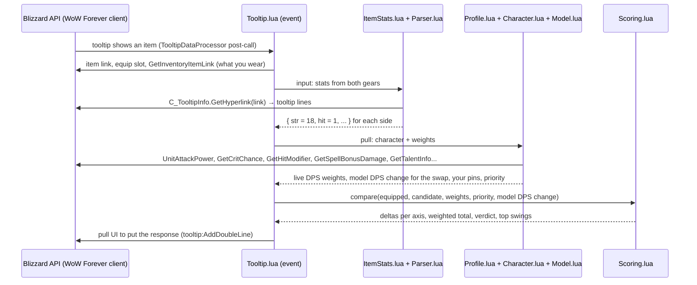

<p align="center"></p>

# Forever Gear Scale

A **WoW Forever** addon that answers "is this piece better for me?" right in the item tooltip.
It is built for **Retribution Paladins only**. It reads your **character sheet and talents**, runs a small Ret damage model on them, and scores the item you hover against what you wear on **three axes**: **DPS**, **Defense** and **Sustain**.

The DPS weights are **live**: they are worked out from your current stats, so they change as you gear. Hit is worth nothing once you are at the cap, crit is worth less once Vengeance never drops, and Intellect is worth more with Champion of the Light. Swaps are scored on the full model, not with linear weights, so a piece that takes you over the hit cap only gets credit for the hit that still counts.

It is the in-game version of the *Gear Scale* web page (Ret Paladin), with the same stat ids, scale and verdict rules. On other classes the addon does nothing.

```
Lionheart Helm
...
Gear Scale · Retribution                Upgrade
  DPS      1 850 > 2 000                   +150
  Defense    560 > 650                      +90
  Sustain      0 > 0                          0
  Weighted total                           +173
  Shift: biggest stat swings
```

## Install

1. Download this repo (**Code → Download ZIP**, or `git clone`) and put it in the **Interface/AddOns** folder of your **WoW Forever** install. That is the Forever game folder, not the Classic Era or retail one. The folder must be named exactly `ForeverGearScale`: a ZIP download unpacks as `ForeverGearScale-main`, so rename it.
2. Restart the game, or `/reload`. Make sure **Forever Gear Scale** is ticked in the AddOns list on the character screen.
3. Hover any piece of gear.

## Usage

| Command | What it does |
|---|---|
| `/fgs status` | What was read from your character (AP, crit, hit, weapon, spell damage, talents), the model's DPS split, average Vengeance stacks, and anything it had to guess |
| `/fgs weights` | The weights in use (points per 1 point of stat, per axis). DPS weights are live; `*` marks the ones you pinned |
| `/fgs prio 100 25 40` | Axis priority in %. Raise Defense for leveling or solo play, Sustain for long fights |
| `/fgs weight <stat> <dps> <def> <sus>` | Pins one stat's weight by hand. It stops following the model |
| `/fgs unpin <stat>` | That stat follows the model again |
| `/fgs set target 63` | Target level (default: your level + 3, a raid boss) |
| `/fgs set judge 9` | Seconds between Judgements of Command (default 9) |
| `/fgs set execute 0.2` | Share of the fight spent under 20% health, where Hammer of Wrath is used (default 0.2) |
| `/fgs set vengeance\|champion\|holyshock <rank\|auto>` | Talent rank, if the client can't read it (or to test a build) |
| `/fgs talents` | Dumps what the talent API returns and the ranks read: paste it in a bug report |
| `/fgs reset` | Unpins everything; priority, fight and talent settings back to default |
| `/fgs export` / `/fgs import <string>` | Copy weights as text: `str=10/0.3/0;agi=3.5/4/0;…\|prio=100/25/40`. Imported stats are pinned |
| `/fgs on` / `/fgs off` | Shows or hides the tooltip lines |

Hold **Shift** while hovering to see the 4 stats that move the score most, and how many special effects (on-use, procs) were not scored.

---

## 1. Plan

| # | Step | Status |
|---|---|---|
| 1 | Check the Forever addon API: Interface **16001**, modern `C_*` API with Midnight-era restrictions | ✅ |
| 2 | Stat vocabulary and **Ret weight table** matching the web page (other classes removed in 0.2) | ✅ |
| 3 | **Tooltip parser** (EN + FR) from item tooltip text to stat values | ✅ |
| 4 | **Scoring engine**: 3 axes, deltas, axis priority, verdict (same rules as the web page) | ✅ |
| 5 | ~~Class/spec detection~~ removed in 0.2: Paladin only. Replaced by **reading the character sheet and talents** | ✅ |
| 6 | **Tooltip hook**: find the equipped item(s) in the slot, compare, write the result | ✅ |
| 7 | Slash commands: tune weights and priority, import/export | ✅ |
| 8 | Offline tests with a stubbed game API + CI | ✅ |
| 9 | **In-game check on Forever**: verify API names, tooltip text and talent info on the live client | ⏳ needs a game client |
| 10 | **Live DPS weights** from a Ret model (Seal of Command, Judgement, Holy Shock, Hammer of Wrath, Vengeance, Champion of the Light) | ✅ |
| 10b | Check the model's spell numbers (Judgement of Command, Holy Shock) against Forever logs and tune `Model.CONST` | 🔜 |
| 11 | Settings panel (sliders) instead of slash commands only | 🔜 |
| 12 | French UI strings (the parser already reads French tooltips) | 🔜 |
| 13 | Own repository | ✅ |
| 14 | CurseForge packaging and upload (release ZIPs) | ✅ |

## 2. Architecture

It follows the hand-drawn sequence: **codebase ↔ Blizzard API**.



### Files (loaded in this order)

| File | Role | Uses the game API? |
|---|---|---|
| `ForeverGearScale.toc`, `ForeverGearScale_Camelot.toc` | Manifest, `## Interface: 16001`. Same file twice, so the client finds it with either suffix rule | — |
| `Compat.lua` | Wraps the Blizzard calls, with fallbacks to older globals: `C_Item.GetItemInfoInstant`, `C_TooltipInfo.GetHyperlink` (or a hidden scan tooltip), `TooltipUtil.GetDisplayedItem`, `issecretvalue` | yes, only here |
| `Data/Stats.lua` | Stat ids and names, the same as the web page | no |
| `Data/Presets.lua` | **Ret weight table** (`NS.RET`): Defense and Sustain weights, and the fallback DPS column | no |
| `Parser.lua` | Tooltip text to stats, English and French. Skips set bonuses, flavor text, *Use:* and *Chance on hit:* (counted as "not scored") | no |
| `ItemStats.lua` | Link to stats, with a cache. Removes enchants and gems so the equipped piece isn't favoured by its enchant | through Compat |
| `Model.lua` | **Ret damage model**: attack tables, Seal of Command, Judgement, Holy Shock, Hammer of Wrath, Vengeance stacks. Gives live weights and the exact DPS change of a swap | no |
| `Character.lua` | Reads the character sheet and talents (by name, EN + FR) into a model state. Secret or missing values fall back to the last good reading, then defaults | yes |
| `Scoring.lua` | Points per axis, deltas, priority-weighted total, verdict (*Upgrade / Downgrade / Trade-off / Sidegrade*), biggest swings | no |
| `Profile.lua` | Paladin check, then model weights + the Ret table + your pinned stats | yes |
| `Tooltip.lua` | Event hook + rendering. Handles rings and trinkets (best of 2 slots), two-handers (vs main + off hand), empty slots, your own equipped item | yes |
| `Commands.lua` | `/fgs` and import/export | yes |
| `Core.lua` | SavedVariables (`ForeverGearScaleDB`, migrated from 0.1), event wiring (gear, stats, talent changes, Shift key) | yes |

Logic files (`Parser`, `Model`, `Scoring`, `Data/*`) never touch the game API, so they are tested offline. Every Blizzard call goes through `Compat.lua` or is guarded with `pcall`. If Forever renames something, it fails quietly instead of throwing Lua errors.

### Scoring rules

- **Score** for each axis = Σ (stat value × weight on that axis).
- **DPS delta** comes from the model: DPS with the new piece (your sheet − the equipped piece + the candidate) minus DPS now, turned into points (1 AP = 5 pts). Pinned stats use their weight instead.
- **Defense and Sustain delta** = candidate − equipped, with the fixed weights. An axis is "even" when it moves by less than 1% (and less than 3 points).
- **Verdict** uses only the axes whose priority is above 0: gains only → *Upgrade*, losses only → *Downgrade*, both → *Trade-off*, neither → *Sidegrade*.
- **Weighted total** = Σ delta × priority / 100. Rings and trinkets are compared with both equipped pieces, and the slot with the best total is shown ("vs Ring 2").

### Scale (weights)

Same anchors as the web page: **1 Attack Power = 5 pts**, **Defense 1 pt ≈ 1 effective HP** (1 Stamina = 10 pts), **Sustain 1 pt ≈ 2.5 mana**.

### The Ret model (DPS axis)

Each DPS weight is 5 × (DPS gained by 1 point of the stat) ÷ (DPS gained by 1 AP), measured at your current stats. The model covers:

- **Melee attack table** against the target level (default your level + 3): miss (9% cap vs a boss), dodge, glancing blows, crit suppression, weapon skill.
- **White swings** with your weapon DPS and speed, plus Attack Power.
- **Seal of Command**: 7 procs per minute, 70% weapon damage + 20% of spell damage. Slower weapons hit harder per proc, so weapon speed counts on weapon swaps.
- **Judgement of Command** every 9 sec (spell hit, melee crit), **Holy Shock** every 30 sec if you have it (spell hit and crit), **Hammer of Wrath** in the execute phase.
- **Vengeance**: +1% damage per rank per stack, 5 stacks, 30 sec. Every non-periodic hit above can crit and refresh it. The average stack count is solved exactly from your crit chance and hit rate, so crit is worth a lot at low crit and little once the buff never drops.
- **Champion of the Light**: 12% of Intellect per rank as spell damage, so Intellect picks up spell damage's value.
- Strength = 2 AP, 20 Agility = 1% crit, 54 Intellect = 1% spell crit.

Spell values are vanilla level-60 numbers (`Model.CONST`). Forever reworked talents and some spells, so check `/fgs status` against your logs and adjust there. Not modelled: mana (it's the Sustain axis), on-use and proc effects, set bonuses, % stat buffs such as Blessing of Kings.

### Forever API notes (checked November 2026)

- Forever is its own game type (client 1.60.x) with TOC **Interface 16001**. In game, `/dump select(4, GetBuildInfo())` should print `16001`. Sources disagree on the TOC suffix (`_Forever` vs. the internal `_Camelot`), so we ship a plain `.toc` plus `_Camelot.toc`.
- It runs the **modern addon API** (Midnight's), not Classic Era's. Use `C_Item.*`, `C_TooltipInfo.*` and `TooltipDataProcessor.AddTooltipPostCall` instead of the old `GetItemInfo` / `OnTooltipSetItem`. The addon still falls back to the old calls when the new ones are missing.
- Combat data can come back as *secret values*. We skip a tooltip when its item link is secret.
- To check in game: `/fgs debug` prints any error from the tooltip hook to chat.

## Development

```sh
# from this folder
lua5.1 tests/run.lua
```

`tests/run.lua` stubs the WoW API (items, equipped slots, character sheet, talents, tooltips), loads every file in TOC order, and checks the parser (EN/FR, weapon speed), the model (Vengeance chain against a simulation, hit cap, crit falloff, Champion of the Light, weapon speed), scoring, reading the character (missing API, secret values), commands, saved-variable migration and the full tooltip flow (upgrade, equipped item, Shift details, rings, two-handers, empty slots). CI (GitHub Actions) runs it on every push and pull request.

### Versions and release tags

Releases follow CurseForge's three release types, read from the git tag name (the same rule the BigWigs packager uses):

| Tag | CurseForge type |
| --- | --- |
| `v0.1.0-alpha.1` | Alpha (contains `alpha`) |
| `v0.1.0-beta.1` | Beta (contains `beta`) |
| `v0.1.0` | Release (anything else) |

The `## Version:` line in both `.toc` files matches the tag without the `v`.

**To cut a release, bump `## Version:` in both `.toc` files and merge to `main`.** No manual tag is needed: `.github/workflows/release.yml` runs on every push to `main`, and when the version has no tag yet it creates `v<version>` on that commit and releases it. Pushes that don't change the version release nothing. Pushing a `v*` tag by hand also works.

The workflow:

1. runs the syntax check and the tests;
2. checks the tag name and that both `.toc` versions match it (`.github/scripts/package.sh`, which you can also run locally);
3. builds `ForeverGearScale-<version>.zip` (a `ForeverGearScale/` folder with the `.toc` files, Lua files, `Data/`, README and LICENSE);
4. creates the tag if it came from a version bump, then a GitHub release with that zip and a changelog built from the commits since the previous tag. Alpha and beta releases are marked as pre-releases;
5. uploads the zip to CurseForge with the matching release type, but only once these are set under *Settings → Secrets and variables → Actions*:
   - secret `CF_API_KEY`: a CurseForge API token (legacy.curseforge.com → Account → API tokens);
   - variable `CF_PROJECT_ID`: the project's numeric id;
   - variable `CF_GAME_VERSION_IDS`: comma-separated CurseForge game version ids for the Forever client.

   Without `CF_PROJECT_ID`, that step is skipped and only the GitHub release is made.

This addon started in the guild website repo ([patriotesazeroth-web](https://github.com/terry-turcotte/patriotesazeroth-web)) and was split out with its history.

## Logo

`media/logo.svg` is the source of the logo, with PNG exports at 512, 256 and 64 px; use `logo-512.png` as the CurseForge project logo. It is original artwork: a balance scale in a cog, with three bars for the DPS, Defense and Sustain axes. The lettering is [Cinzel](https://github.com/NDISCOVER/Cinzel) (SIL Open Font License), converted to outlines. `media/make_logo.py` regenerates the SVG. The `media/` folder is not included in the release zip.

In the game's AddOns list, both `.toc` files use a game icon (`## IconTexture: Interface\Icons\INV_Misc_Gear_01`), so no Blizzard file is copied into the addon. Clients without `IconTexture` support ignore the line.

## License

[MIT](LICENSE)
